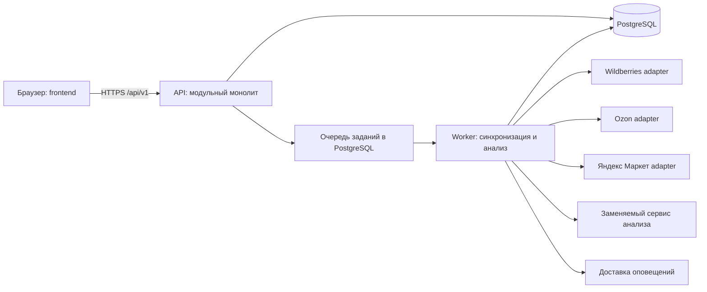

# Архитектура MVP «Сигнал»

## Продукт и границы

Сервис для продавца, который подключает свои кабинеты маркетплейсов, получает единую ленту отзывов и видит повторяющиеся причины недовольства. Основной сценарий: **подключить кабинет → загрузить отзывы → объединить жалобы → проверить источники → назначить действие → отследить динамику**.

Первая версия интерфейса уже реализована на моковых данных. Ни один из серверных компонентов ниже пока не создавался. Это целевая архитектура следующего этапа, а не описание существующего бэкенда.

## Основное решение

Начать с **модульного монолита и отдельного процесса фоновой обработки** из одного репозитория. Одна PostgreSQL для операционных данных, аналитики и надёжной очереди заданий. На старте не нужны микросервисы, Kafka, ClickHouse, отдельная векторная БД и Kubernetes.



**Стек следующего этапа:** TypeScript, Node.js, Fastify для API, PostgreSQL, SQL-миграции и очередь на PostgreSQL (например, pg-boss). Конкретные версии фиксируются при серверном старте после проверки совместимости. Один язык уменьшает накладные расходы небольшой команды; PostgreSQL покрывает нужные фильтры, агрегации и полнотекстовый поиск без дополнительных сервисов.

**Фронтенд сейчас:** TypeScript ES-модули, CSS, небольшая оболочка и моковый адаптер; внешних пакетов нет. Это автономный прототип для проверки сценариев. При развитии сложных форм и многопользовательской работы — React + TypeScript + Vite, маршрутизация и TanStack Query для серверного состояния. Доменные типы и расчёты переносятся; слой шаблонов и обработчиков заменяется. SSR для закрытого кабинета не нужен. Не следует считать текущую сборку с удалением аннотаций полноценной TypeScript-проверкой.

## Серверные модули

| Модуль | Ответственность |
|---|---|
| Identity / Workspaces | Вход, пользователи, команды, роли, границы доступа |
| Connections | Кабинеты площадок, зашифрованные реквизиты, проверки доступа, возможности API |
| Catalog | Внутренние товары, варианты, карточки площадок, ручное сопоставление SKU |
| Reviews | Нормализованные отзывы, исходные поля, редактирования и история |
| Sync | Периодическая загрузка, курсоры, ограничения API, повторы, прогресс |
| Topics | Темы, связи с отзывами, разметка причин, версии анализа, ручные исправления |
| Analytics | Фильтрованные агрегаты, динамика, источники и сравнительные периоды |
| Work | Статус темы, задачи, ответственные, сроки и комментарии |
| Alerts / Reports | Правила, события, дедупликация и доставка отчётов |
| Audit | Кто подключил кабинет, изменил группировку или настройки |

Модули вызывают публичные сервисы друг друга. HTTP-обработчик не ходит напрямую в SDK маркетплейса; worker не содержит бизнес-правил UI. API и worker масштабируются отдельными процессами, оставаясь одним продуктом и кодовой базой.

## Модель данных

| Сущность | Основные поля и ограничения |
|---|---|
| Workspace / Membership | Команда; `(workspace_id, user_id, role)` |
| MarketplaceConnection | `workspace_id`, площадка, кабинет, зашифрованные реквизиты, `capabilities`, статус, время последней успешной загрузки |
| Product / Variant | Внутренняя карточка бренда и вариант товара |
| MarketplaceListing | Внешний ID/SKU, связь с вариантом; уникальность в пределах подключения |
| Review | `workspace_id`, подключение, внешний ID, listing, оценка, текст, даты, исходный статус и `source_url`, если он доступен |
| ReviewVersion | Хеш/версия содержимого, исходный payload с политикой хранения; не хранить токены |
| Topic | Название, причина, приоритет, версия модели, время первого обнаружения, состояние |
| TopicReview | Отзыв ↔ тема, уверенность, цитата-основание, происхождение назначения, ручное исключение |
| TopicWork / Comment | Ответственный, срок, состояние, комментарии и авторы |
| SyncRun / SyncCursor | Прогресс, история ошибок, курсор, контрольная точка загрузки |
| AlertRule / AlertEvent / Delivery | Условия, сработавшее событие, ключ дедупликации, результат доставки |

Один отзыв может относиться к нескольким темам. Поэтому «упоминания темы», «число уникальных негативных отзывов» и «доля объяснённого негатива» — разные метрики. Для последней использовать `count(distinct review_id)`. В демо темы намеренно не пересекаются, чтобы цифры легко проверялись.

**Изоляция команд:** каждая бизнес-таблица содержит `workspace_id`; составные FK/уникальные ограничения не дают связать объекты разных команд. Workspace определяется из аутентифицированной сессии и membership, а не доверяется параметру клиента. Все запросы ограничены командой; PostgreSQL RLS можно добавить как второй уровень защиты.

**Индексы для старта:** `(workspace_id, published_at desc, id)`, `(connection_id, external_review_id)` unique, `(workspace_id, listing_id, published_at)`, `(workspace_id, topic_id, review_id)` и индекс очереди по состоянию и времени запуска. Полнотекстовый поиск по тексту — PostgreSQL; размеры и планы запросов проверяются на реальных данных.

**Партии:** маркетплейсы не обязаны возвращать заводскую партию вместе с отзывом. `batch_id` должен быть nullable. Связь с поставкой/партией строится из собственного учёта продавца, импорта или ручной разметки, с указанием происхождения и степени уверенности. Нельзя выдавать предположение за факт.

## Контракт адаптера маркетплейса

```ts
interface MarketplaceAdapter {
  verifyCredentials(credentials: EncryptedCredentialRef): Promise<Capabilities>;
  listListings(input: ListingPageRequest): Promise<Page<NormalizedListing>>;
  listReviews(input: ReviewPageRequest): Promise<Page<NormalizedReview>>;
}
```

Общий результат не скрывает различия: возможности чтения, история, ограничения, наличие ссылок и дополнительных полей задаются `Capabilities`. Реквизиты — discriminated union по площадке, а не универсальная строка `apiToken`. Например, форма Ozon предусматривает Client-Id и API-ключ. Полученные capabilities определяют доступные функции UI.

Доступ к отзывам зависит от условий конкретного кабинета. Ozon объявил обновлённые методы `/v2/review/*` и новую модель статусов в апреле 2026; нельзя строить интеграцию только на старом примере `/v1/review/list`. Условия подписок также менялись. Адаптер должен проверять доступ и показывать продавцу понятную причину ограничения. Источники: [обновление методов Ozon](https://dev.ozon.ru/news/695-Obnovleniia-v-metodakh-dlia-raboty-s-otzyvami-i-voprosami-v-Seller-API/), [изменения доступа по подпискам](https://dev.ozon.ru/news/634-Novye-metody-dlia-poiskovykh-zaprosov-v-Seller-API/), [подписка «Управление отзывами»](https://seller.ozon.ru/media/news/podpiska-upravlenie-otzyvami-i-drugie-izmeneniya-v-dogovore/).

Перед реализацией каждого адаптера сверять актуальные методы, категории доступа и лимиты в официальных спецификациях: [Wildberries](https://dev.wildberries.ru/openapi/user-communication), [Ozon Seller API](https://docs.ozon.ru/api/seller/), [Яндекс Маркет](https://yandex.ru/dev/market/partner-api/doc/ru/). Точные лимиты здесь намеренно не зафиксированы. Наличие площадки на макете не подтверждает доступность API для любого продавца.

## Загрузка и согласованность

1. API принимает реквизиты по HTTPS, проверяет права, сохраняет только шифротекст и создаёт SyncRun.
2. Worker загружает карточки и историю страницами. Глубина истории зависит от API и выбранного периода; не обещать заранее «все отзывы за полгода».
3. После каждой успешно сохранённой страницы транзакционно обновляются курсор и счётчики. Повтор после сбоя не создаёт дубликатов благодаря уникальному внешнему ID в пределах подключения.
4. Дальше запускается инкрементальная загрузка с небольшим перекрытием временного окна для поздних и отредактированных отзывов. Курсоры и стратегии задаются конкретным адаптером.
5. Для 429/5xx — ограниченные повторы с backoff, jitter и учётом Retry-After. Для 401/403 — остановка подключения и запрос переподключения; не бесконечные повторы.
6. Состояния `validating / importing / ready / degraded / auth_expired` и время последней успешной загрузки видны продавцу. Устаревшие данные сохраняются с явной отметкой.

Ограничивать параллелизм отдельно на кабинет и площадку, а задания дедуплицировать. Доставка очереди — at least once, обработчики — идемпотентны. Изменения данных и события на анализ/доставку фиксировать транзакционно, например через outbox. При остановке worker незавершённое задание должно вернуться в очередь.

## Анализ тем и проверяемость

- Оценка 1–3 задаёт исходную негативную выборку; жалобы внутри высоких оценок можно добавить отдельным этапом, не смешивая определения метрик.
- Извлечение проблемы и причины → нормализация формулировок → поиск существующей темы → уверенное назначение или новая тема. Сомнительные случаи сохранять как нераспределённые.
- Вывод хранит ссылки на Review и цитаты-основания. Уверенность модели — оценка, не доказанная вероятность и не гарантия корректности.
- AI-провайдер скрыт за интерфейсом. Можно начать с batch-классификации ограниченного числа отзывов; embeddings/pgvector добавлять, если измерения качества покажут необходимость.
- Перед внешним анализом удалять ненужные персональные данные, передавать только необходимый текст и держать предел стоимости/объёма.
- Хранить версии модели, промпта и группировки; повторный анализ не отменяет ручные исключения. У ручного решения выше приоритет.
- Краткий вывод отделяет наблюдение («52 из 64 отзывов») от гипотезы («возможен дефект уплотнителя»). Действия с остатками товара не выполняются автоматически.
- В маленьком контрольном наборе вручную оценивать точность тем, ложные объединения, пропущенные жалобы и качество выделения причины. Интерфейс позволяет исправить ошибку.

## API для фронтенда

```text
GET    /api/v1/workspaces/:id/summary?from=&to=&marketplace=&productId=
GET    /api/v1/workspaces/:id/reviews?cursor=&limit=&q=&rating=&topicId=
GET    /api/v1/workspaces/:id/topics?from=&to=&cause=&sort=
GET    /api/v1/workspaces/:id/topics/:topicId
PATCH  /api/v1/workspaces/:id/topics/:topicId/work
POST   /api/v1/workspaces/:id/topics/:topicId/exclusions
POST   /api/v1/workspaces/:id/topics/:topicId/comments
POST   /api/v1/workspaces/:id/connections
GET    /api/v1/workspaces/:id/connections/:connectionId/sync-runs
DELETE /api/v1/workspaces/:id/connections/:connectionId
GET    /api/v1/workspaces/:id/exports/reviews.csv
```

Сервер проверяет membership для каждого workspace из URL. DTO валидируются на границе; единые ошибки имеют `code`, безопасное `message`, `requestId`. Для длинных списков — cursor pagination по `(published_at, id)`, для выгрузок — те же фильтры, что в UI. Периоды задавать явно с timezone команды, сервер хранит timestamps в UTC. Событие отключения кабинета прекращает новые загрузки; удаление исторических данных — отдельная операция.

Контракт источника `src/data/reviewRepository.ts` сейчас синхронный, потому что данные локальные. HTTP-адаптер сделает его асинхронным; потребуется загрузка/ошибка/пустое состояние и отмена устаревших запросов. Нельзя обещать заменить mock на fetch одной строкой без этого этапа.

## Токены, доступ и наблюдаемость

- Ключи маркетплейсов остаются на сервере. Никогда не отдавать их в браузер, localStorage, HTML, логи, репозиторий и выгрузки.
- Шифровать реквизиты на уровне приложения отдельным master key/KMS, хранить версию ключа, поддержать ротацию. Production-секреты поступают из secret store окружения.
- Сессионная аутентификация с HttpOnly/Secure cookies; для cookie-based изменяющих запросов — защита от CSRF. В MVP достаточно ролей owner и analyst; менять подключения может owner.
- UI не получает функцию ответа покупателю, если продукт пока только читает отзывы. Отправка ответа или изменение карточки потребует отдельного сценария и прав.
- Логи структурированы и не содержат токены/полные тексты по умолчанию. Метрики: длительность и лаг синхронизации, 429/401, глубина очереди, повторы, расход анализа, доля нераспределённых отзывов.
- Резервные копии PostgreSQL и проверенное восстановление нужны до реальных данных. Политики хранения/удаления и требования к размещению уточняются при подключении первых продавцов.

## Развёртывание и порядок реализации

**Пилот:** статический frontend + API + worker + PostgreSQL. Docker Compose или простой managed-hosting; одна команда, один регион и ограниченный набор кабинетов. TLS и reverse proxy, миграции отдельным шагом. API и worker запускаются из одного образа разными командами. PostgreSQL недоступна напрямую браузеру.

1. **Сейчас:** согласовать навигацию, структуру тем и карточку проблемы по текущему прототипу; собрать обратную связь продавца.
2. **Первый рабочий контур:** workspace/login, защищённое подключение одной площадки, каталог, инкрементальная загрузка, фильтры отзывов, реальные ошибки и прогресс.
3. **Аналитика:** вычисляемые метрики, темы, цитаты-источники, ручные исправления и контроль качества анализа.
4. **Вторая и третья площадки:** адаптеры и сопоставление вариантов товара. Одинаковые названия не считать доказательством одного SKU.
5. **Команда:** задачи, роли, уведомления и отчёты с дедупликацией и контролем доставки.

Выделять сервисы или отдельное аналитическое хранилище только после измерений. Целевые проверки пилота: отсутствие дубликатов после перезапуска загрузки, изоляция команд, остановка при отозванном токене, сохранение ручных исправлений, совпадение CSV с фильтрами и восстановление данных из backup.
